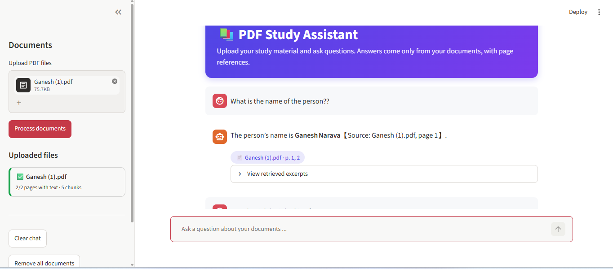

# 📚 AI-Powered PDF Study Assistant (GenAI · LLM · RAG)

🔗 **Live demo:** https://your-app-name.streamlit.app



Upload your study PDFs, ask questions in a chat window, and get answers that come **only from your documents**, with the file name and page numbers used as evidence.

## Overview

The app uses **Retrieval-Augmented Generation (RAG)**. It does *not* paste whole PDFs into the LLM. It splits documents into chunks, stores their embeddings in a FAISS index, retrieves only the few chunks relevant to each question, and asks the LLM to answer from those chunks alone. If the documents don't contain the answer, the app says so instead of guessing.

## Features

- Upload one or many PDFs, with validation (extension, size, real PDF header, corrupt, password-protected and scanned/image-only files handled gracefully)
- Text extraction (PyPDF) and cleaning (ligatures, hyphenated line breaks, control characters)
- Chunking with overlap, local Sentence-Transformers embeddings, FAISS similarity search
- Grounded answers with an explicit "not found in the documents" behaviour
- Chat history with **follow-up question rewriting** ("what about its limits?" becomes a standalone query)
- Source references: file name + page numbers + retrieved excerpts for every answer
- Clean responsive UI: processing status, uploaded-file list, chat window, *Clear chat* and *Remove all documents* buttons

## Technologies

| Area | Tool |
|---|---|
| UI | Streamlit + custom CSS (`assets/style.css`) |
| Language | Python 3.10+ |
| Orchestration | LangChain (`langchain-core`, LCEL `prompt \| llm \| parser`) |
| PDF parsing | PyPDF |
| Chunking | `langchain-text-splitters` (RecursiveCharacterTextSplitter) |
| Embeddings | Sentence-Transformers `all-MiniLM-L6-v2` (runs locally, free) |
| Vector DB | FAISS (`faiss-cpu`) via `langchain-community` |
| LLM | Groq API (default `llama-3.3-70b-versatile`) via `langchain-groq` |

> **Why Streamlit instead of hand-written HTML/JS?** Streamlit lets the whole UI be written in Python, which keeps the project beginner-friendly. HTML/CSS is still used: `assets/style.css` is injected for the custom look.

## System architecture

```
                 ┌──────────────────────── INGESTION (once per upload) ────────────────────────┐
 PDF files ─▶ validate ─▶ PyPDF extract (per page) ─▶ clean text ─▶ split into chunks
                                                                         │
                                                      embed each chunk (MiniLM, 384-dim vectors)
                                                                         ▼
                                                                  FAISS index (in memory)
                                                                         ▲
                 ┌───────────────────────── QUESTION ANSWERING (every question) ──────────────┤
 Question ─▶ (rewrite follow-up using chat history) ─▶ embed question ─▶ similarity search (top-k)
                                                                         │
                         labelled context + question ─▶ prompt ─▶ Groq LLM ─▶ answer + sources
```

## RAG workflow explained

1. **Extract**: PyPDF reads each page; page numbers are kept as metadata.
2. **Clean**: normalise Unicode, remove control characters, rejoin hyphenated words, unwrap hard line breaks.
3. **Chunk**: ~1000-character pieces with 200-character overlap, split at paragraph/sentence boundaries when possible. Each chunk keeps `source` (file) and `page`.
4. **Embed**: each chunk becomes a 384-number vector that captures meaning. Vectors are normalised.
5. **Store**: vectors go into a FAISS index.
6. **Ask**: your question is embedded with the *same* model.
7. **Retrieve**: FAISS returns the `TOP_K` nearest chunks. Chunks beyond `MAX_DISTANCE` are discarded; if none remain, the app answers "not found" without calling the LLM.
8. **Prompt**: the retrieved chunks (labelled with file and page) plus the question go into a strict prompt: *use only this context, otherwise say you can't find it*.
9. **Generate**: the Groq LLM writes the answer (temperature 0 for consistency).
10. **Display**: the answer is shown with source tags and expandable excerpts.

## Project structure

```
pdf-study-assistant/
├── app.py                  # Streamlit UI (upload, status, chat, sources, reset)
├── config.py               # Settings loaded from environment / .env
├── requirements.txt        # Runtime dependencies (version ranges)
├── requirements-dev.txt    # + pytest, reportlab for tests
├── .env.example            # Template for your API key (copy to .env)
├── .gitignore
├── README.md
├── assets/style.css        # UI styling
├── docs/PROJECT_GUIDE.md   # Deep-dive + interview Q&A
├── src/
│   ├── pdf_processor.py    # Validation, PyPDF extraction, text cleaning
│   ├── text_splitter.py    # Chunking with metadata
│   ├── embeddings.py       # Sentence-Transformers embedding model
│   ├── vector_store.py     # FAISS index + similarity search
│   ├── prompt_templates.py # QA and question-rewriting prompts
│   ├── llm_handler.py      # Groq chat model + missing-key error
│   ├── rag_pipeline.py     # Orchestrates everything (ingest + ask)
│   ├── models.py           # Dataclasses (answers, sources, reports)
│   └── utils.py            # Small helpers
└── tests/                  # Unit + pipeline tests
```

## Installation

Requires **Python 3.10+** and an internet connection for the first run (to install packages and download the embedding model, ~90 MB).

```bash
cd pdf-study-assistant

# 1. Create and activate a virtual environment
python -m venv venv
# Windows (PowerShell):  venv\Scripts\Activate.ps1
# Windows (cmd):         venv\Scripts\activate.bat
# macOS / Linux:         source venv/bin/activate

# 2. Install dependencies (the first install is large because of PyTorch)
pip install --upgrade pip
pip install -r requirements.txt
```

## Environment setup & API key

1. Create a free account at <https://console.groq.com> and open **API Keys** → **Create API Key**.
2. Copy the template and add your key:
   ```bash
   cp .env.example .env          # Windows: copy .env.example .env
   ```
3. Edit `.env`:
   ```
   GROQ_API_KEY=your_real_key_here
   ```

`.env` is git-ignored, so your key never gets committed. Optional settings (model, chunk size, top-k, distance threshold) are documented inside `.env.example`. Groq occasionally retires models; if you get a "model not found" error, pick a current one from <https://console.groq.com/docs/models> and set `LLM_MODEL`.

## Running

```bash
streamlit run app.py
```

Open the URL shown (usually <http://localhost:8501>), upload PDFs in the sidebar, click **Process documents**, then ask questions.

Run the tests:

```bash
pip install -r requirements-dev.txt
python -m pytest -v          # or: python -m unittest discover -s tests -t . -v
```

## Example questions to test

Try these with any textbook chapter or lecture notes:

- "Summarize the main topic of this document in 5 bullet points."
- "What is the definition of *<a term from your PDF>*?"
- "Explain *<concept>* in simple words."  → then follow up with: "Can you give an example?"
- "Compare *<concept A>* and *<concept B>*." (with several PDFs uploaded, answers cite each file)
- "What are the key points on page <n>?"
- **Hallucination check:** ask something unrelated, e.g. "Who won the 2018 FIFA World Cup?" The app should say it couldn't find the answer in your documents.

## Troubleshooting

| Problem | Cause / fix |
|---|---|
| `GROQ_API_KEY is not set` banner | Create `.env` from `.env.example`, add the key, **restart** Streamlit. |
| "No extractable text found" | The PDF is scanned images. OCR is not supported (see Future enhancements). |
| "password-protected" | Remove the password and re-upload. |
| Model download is slow / fails | First run downloads the embedding model from Hugging Face. Check your internet connection and retry. |
| `ModuleNotFoundError` | Activate the venv and run `pip install -r requirements.txt` again. |
| `faiss` install fails | Use Python 3.10–3.12 and upgrade pip. On Apple Silicon try `pip install faiss-cpu --no-cache-dir`. |
| "model_decommissioned" / "model not found" | Set a currently available `LLM_MODEL` in `.env`. |
| Rate-limit (429) errors | Free tiers have limits. Wait a minute and retry. |
| Answers say "not found" too often | Raise `MAX_DISTANCE` (e.g. 1.6) or `TOP_K` in `.env`. |
| Answers seem unrelated | Lower `MAX_DISTANCE` (e.g. 1.2) or use smaller `CHUNK_SIZE`. |

## Known limitations

- The index lives in memory and is rebuilt on every *Process documents* click (nothing is saved to disk).
- Scanned PDFs, tables and images aren't understood (text extraction only).
- Chunks don't cross page boundaries, so a sentence split across two pages is indexed as two pieces.
- Source pages show where evidence was *retrieved from*; the LLM is instructed to use only that content, but this is prompt-enforced, not mathematically guaranteed.

## Future enhancements

OCR for scanned PDFs (Tesseract), persisting the FAISS index to disk, hybrid search (BM25 + vectors), a cross-encoder re-ranker, streaming token output, quiz/flashcard/summary generation modes, per-document filtering, multilingual embeddings, automated retrieval-quality evaluation (e.g. RAGAS), user accounts and Docker deployment.
